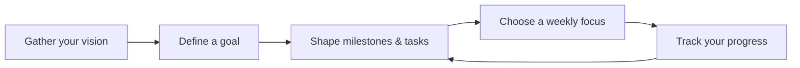

<div align="center">


<br />

**A thoughtful space for big dreams and small, steady steps.**

Turn a vision board into editable milestones, manageable tasks, and meaningful progress.

[](https://github.com/Prarth314/Elevatria-uplift-your-life/actions/workflows/ci.yml)


[](LICENSE)

[Explore the workflow](#the-workflow) · [Run locally](#quick-start) · [Architecture](#under-the-surface) · [Roadmap](#where-elevatria-is-going)

</div>

<br />

## Make room for what’s next

Elevatria is a visual goal-planning application built around a simple idea: the future you imagine deserves a practical next step.

Keep your inspiration in sight, define what success looks like, break a goal into milestones, and track the work as it happens. The experience pairs a botanical palette and editorial typography with clear editing interactions, realistic effort estimates, and room to change direction.

The project focuses on maintainable architecture, reliable planning behavior, and a future AI-assisted workflow.

> **Current release · Milestone 1**<br />
> A working local demo with browser persistence and template-based plan generation. No signup, AI key, backend setup, or paid service is required. Authentication, server AI, automatic scheduling, and Calendar sync are planned, not active features.


<p align="center"><sub>The actual local application, showing the included sample project.</sub></p>

## The workflow



| Step | What you can do today |
| :--- | :--- |
| **01 · Imagine** | Pin notes and images to a central vision board. Connect inspiration to a goal or keep it independent. |
| **02 · Define** | Describe the outcome, choose a target date, set available weekly hours, and record constraints. |
| **03 · Make it actionable** | Generate a local starter plan, then edit, add, or remove milestones and tasks. Adjust task durations to match the actual work. |
| **04 · Find your focus** | View the next incomplete tasks that fit the weekly effort budget, in plan order. |
| **05 · Keep moving** | Complete or reopen tasks, watch progress update, and revise the plan manually as you learn. |

### Start with a real example

The included **Build an AI study assistant** sample contains three milestones, nine concrete tasks, and two completed tasks. Explore the journey from interviewing students to building, testing, and explaining a portfolio project. The sample describes a project you could build; it does not mean an AI study assistant is embedded in Elevatria.

Load the sample from the sidebar on desktop or the footer on mobile. Choose **Start fresh** when you are ready for your own board. Replacing a board or an existing plan requires confirmation.

## Thoughtful details

- **A board that stays central.** Goal cards, image pins, and notes keep the reason behind the work visible.
- **Plans you own.** Edit every milestone, task title, and estimate instead of accepting an opaque generated answer.
- **Progress with context.** Completion is weighted by estimated task duration, so a five-minute task and a two-hour task contribute differently.
- **A more realistic pace.** Weekly focus respects an effort budget; a capacity warning flags when remaining work exceeds the estimated time before the target date.
- **Persistence that explains itself.** Saved data is validated. Read failures, quota errors, and changes from another tab are shown with recovery options.
- **A usable small screen.** Responsive layouts, keyboard-operable controls, Escape-to-close dialogs, restored focus, and reduced-motion styling support the core workflow.
- **No setup before exploration.** The demo opens with a complete sample, and all planning features work without an AI service.

## Quick start

### 1. Check the prerequisites

| Tool | Version |
| :--- | :--- |
| Node.js | **24 or newer** |
| pnpm | **11.25.0**, pinned in `package.json` |
| Git | Needed to clone the repository |

```sh
node --version
npm install --global pnpm@11.25.0
pnpm --version
```

If the pinned pnpm version is already installed, skip its installation command. Network access is needed for the initial dependency installation.

### 2. Get the source

```sh
git clone https://github.com/Prarth314/Elevatria-uplift-your-life.git
cd Elevatria-uplift-your-life
```

**Already using the original local export?** Open the nested `elevatria-main` folder. In either case, run commands from the project root containing `package.json`, `pnpm-workspace.yaml`, and `src/`.

### 3. Install and launch

```sh
pnpm install --frozen-lockfile
npm run dev
```

Open the **Local** URL printed in the terminal, normally [http://127.0.0.1:5173](http://127.0.0.1:5173). Keep the terminal running while using the app. Press **Ctrl+C** to stop it.

The root commands work in Windows PowerShell and on macOS/Linux. They use Node scripts rather than requiring Bash or Unix `cp`.

### 4. Try your first goal

1. Choose **New goal** and describe a concrete outcome.
2. Set a deadline, available weekly hours, and any constraints.
3. Choose **Generate starter plan**, then tailor the milestones and tasks.
4. Add inspiration, complete a task, and inspect the updated progress.
5. Open **Weekly focus** to see the next tasks within your effort budget.
6. Refresh the page to verify saved changes. Use **Export board** to download the workspace as JSON.

### Environment variables

**No `.env` file is required for the current demo.**

[`.env.example`](.env.example) documents an optional public Google OAuth client ID for the retained Calendar prototype and a future server-only AI key. Filling those placeholders does not activate integrations in the current planner. Provider secrets must never be placed in frontend code, `VITE_` variables, or browser storage.

### Useful commands

| Command | Purpose |
| :--- | :--- |
| `npm run dev` | Start the local Vite development server |
| `npm run dev -- --port 5174` | Use a different port |
| `npm run typecheck` | Check TypeScript across the frontend |
| `npm test` | Run planning, validation, progress, and persistence tests |
| `npm run build` | Create the production frontend in `src/frontend/dist` |
| `npm run preview` | Serve the built frontend locally; run the build first |
| `npm run audit` | Scan source for credential patterns without printing matched values |

<details>
<summary><strong>Local setup troubleshooting</strong></summary>

- **The port is occupied:** use `npm run dev -- --port 5174`, then open the URL Vite prints. Storage is specific to an origin, so a different port has a separate demo board.
- **The Node version is too old:** switch to Node 24 or newer. The test runner executes TypeScript with Node’s built-in support.
- **You are in the wrong folder:** check that the current directory contains the root `package.json` and `pnpm-workspace.yaml`.
- **An older pnpm installation behaves differently:** check `pnpm --version` and use the pinned version. The workspace explicitly allows esbuild’s install script and disables optional Biome/sharp scripts.
- **Changes cannot be saved:** follow the in-app storage warning. Export the working board before leaving; if another tab changed the saved board, export any unsaved work and reload.
- **A Browserslist or baseline-data warning appears:** the verified build reports stale browser metadata. This warning alone does not indicate a failed build.

</details>

## Under the surface

### Technology

| Layer | Implementation |
| :--- | :--- |
| Interface | React 19, TypeScript, Vite 5 |
| Styling & interaction | Tailwind CSS, scoped planner CSS, Radix UI dialogs, Lucide icons |
| Routing | TanStack Router; `/` and `/dashboard` open the planner |
| Planning | Pure TypeScript template generation, capacity estimates, and weekly focus selection |
| Persistence | A versioned localStorage workspace behind an injected storage interface |
| Verification | Node’s test runner, TypeScript checks, GitHub Actions |
| Retained experiment | Motoko / Internet Computer source and generated bindings, inactive in the demo |

### Project structure

```text
.
├── src/
│   ├── frontend/
│   │   └── src/
│   │       ├── pages/Planner.tsx      # Workspace composition and actions
│   │       ├── planner/
│   │       │   ├── Editors.tsx       # Editing and confirmation dialogs
│   │       │   ├── model.ts          # Types, runtime validation, progress
│   │       │   ├── planning.ts       # Generator, capacity, weekly focus
│   │       │   ├── persistence.ts    # Validated loading and saving
│   │       │   ├── sample.ts         # Ready-to-explore example
│   │       │   └── planner.css       # Responsive visual design
│   │       └── components/ui/        # Existing UI primitives
│   └── backend/                     # Retained Motoko prototype
├── tests/planner.test.ts             # Meaningful domain/storage tests
├── scripts/                          # Portable commands and source audit
├── docs/                             # Assessment, decisions, verification
├── .github/workflows/ci.yml           # Install → typecheck → test → build
└── vercel.json                       # Future static frontend configuration
```

Planning logic and persistence are separate from the UI so they can be tested independently and later connected to a server. Runtime validation checks dates, durations, IDs, workspace limits, image formats, and goal references before data is accepted from storage.

The original prototype landing page, dashboard, admin screen, themes, Calendar modules, assets, and generated bindings remain in the repository for reference. The old member/admin screens are not part of the active routes. Original dependencies are being migrated incrementally rather than removed wholesale.

### Why keep the Motoko source inactive?

The exported actor stores Calendar link metadata and includes platform-specific blob-storage code. It has no goal or task API, and its compiler/storage setup needs separate work. Milestone 1 therefore runs independently of it.

The recommended next step is an authenticated API with a relational database and server-only AI access. This offers a direct path to ownership checks, structured responses, and reliable Calendar reconciliation while preserving the original ICP experiment. See the [architecture decision](docs/ARCHITECTURE.md) for the tradeoffs.

## Clear about what works

| Area | Current behavior | Still to build |
| :--- | :--- | :--- |
| Plan generation | A transparent, editable local template | Server AI with validated structured responses |
| Availability | Weekly effort budget and rough deadline capacity | Specific time windows, time zones, dependencies, and scheduled slots |
| Constraints | Recorded with the goal and displayed beside the plan | Automatic interpretation or enforcement |
| Replanning | Manual edits; replacing a plan requires confirmation | Proposed rescheduling with a user-reviewed diff |
| Identity & storage | One shared demo workspace per browser origin | Authentication, user isolation, cloud persistence, and cross-device sync |
| Export | Workspace JSON download | Import/restore UI and idempotent Calendar export/sync |

**Your data stays in this browser’s demo workspace.** The key is `elevatria.workspace.v1`. There is no account boundary or encrypted cloud store. Clearing site data removes saved work; avoid sensitive information. Legacy board/chat entries are left untouched, and the former prototype’s provider-key entry is removed on startup without reading it.

Weekly focus preserves task order and stops when the next task cannot fit; it does not split work or solve dependencies. Capacity assumes a uniform daily share of weekly hours through the target day. Both are planning aids rather than calendar guarantees.

## Verification

The current implementation has passed the frozen dependency install, full frontend type check, seven behavior-test groups, production build, and GitHub CI. Tests cover plan structure and unique IDs, schema rejection, weighted progress, complete/reopen behavior, deadline capacity, weekly effort bounds, persistence, and storage failures.

The main workflow was also exercised in a browser at **1440 × 1000** and **390 × 844**, including editing, image validation and persistence, keyboard completion, focus restoration, empty states, export, and conflict recovery between two tabs. No horizontal overflow was observed at those sizes.

These checks do not establish production readiness or a formal accessibility certification. External AI, authentication, Motoko deployment, Calendar writes, and automated scheduling have not been enabled or verified.

[Read the verification record →](docs/VERIFICATION.md)

## Where Elevatria is going

- [x] **Milestone 1 · Make the core workflow reliable**<br />
  Vision boards, editable goals and plans, progress, sample project, local persistence, responsive UI, and behavior tests.
- [ ] **Milestone 2 · Connect identity, storage, and AI**<br />
  Authenticated sessions, ownership-checked storage, server-only AI, validated output, explicit loading/failure/retry states, and a labeled demo fallback.
- [ ] **Milestone 3 · Help the plan adapt to real life**<br />
  Availability- and dependency-aware scheduling, user-reviewed replanning, and Calendar sync with duplicate prevention and visible failure recovery.

## Hosting

The frontend produces static files in `src/frontend/dist`. [`vercel.json`](vercel.json) contains a future Vercel configuration with a `/dashboard` SPA rewrite. No hosted deployment has been created or verified.

The original `build.sh`, `deploy.sh`, `Dockerfile`, `icp.yaml`, and canister definitions belong to the retained ICP export. They require separate tooling and platform-specific runtime support; they are not needed to run the current frontend. Fonts use Google Fonts with system/Georgia fallbacks.

## Project notes

- [Codebase assessment](docs/ASSESSMENT.md) — what the original export actually implements.
- [Architecture decision](docs/ARCHITECTURE.md) — current boundaries and backend tradeoffs.
- [Verification record](docs/VERIFICATION.md) — checks performed and their limits.
- [MIT license](LICENSE) — original license preserved.

Developed by **[Prarth Gupta](https://github.com/Prarth314)**. Existing generated scaffolding, reference screenshots, and botanical art are preserved. The active board landscape is drawn in CSS; interface icons come from Lucide. The README banner is a repository-native SVG, and the preview is an actual application screenshot.

---

<div align="center">

### Open source. Room to grow.

[](LICENSE)

Free to use, modify, and share under the **[MIT License](LICENSE)**.<br />
Keep the copyright and license notices with redistributed copies.

</div>

<details>
<summary><strong>Read the full MIT License</strong></summary>

```text
MIT License

Copyright (c) 2026
Copyright (c) 2026 Prarth Gupta

Permission is hereby granted, free of charge, to any person obtaining a copy of
this software and associated documentation files (the "Software"), to deal in
the Software without restriction, including without limitation the rights to
use, copy, modify, merge, publish, distribute, sublicense, and/or sell copies of
the Software, and to permit persons to whom the Software is furnished to do so,
subject to the following conditions:

The above copyright notice and this
permission notice shall be included in all copies or substantial portions of the
Software.

THE SOFTWARE IS PROVIDED "AS IS", WITHOUT WARRANTY OF ANY KIND,
EXPRESS OR IMPLIED, INCLUDING BUT NOT LIMITED TO THE WARRANTIES OF
MERCHANTABILITY, FITNESS FOR A PARTICULAR PURPOSE AND NONINFRINGEMENT. IN NO
EVENT SHALL THE AUTHORS OR COPYRIGHT HOLDERS BE LIABLE FOR ANY CLAIM, DAMAGES OR
OTHER LIABILITY, WHETHER IN AN ACTION OF CONTRACT, TORT OR OTHERWISE, ARISING
FROM, OUT OF OR IN CONNECTION WITH THE SOFTWARE OR THE USE OR OTHER DEALINGS IN
THE SOFTWARE.
```

</details>

<p align="center">
  <sub>© 2026 Prarth Gupta · Licensed under MIT.</sub><br />
  <br />
  <em>Built for intention. Made for real life.</em><br />
  <sub>Elevatria — Uplift Your Life</sub>
</p>
