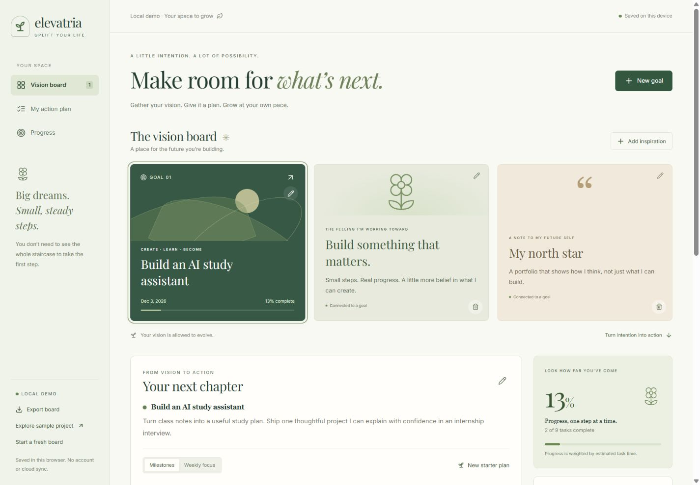
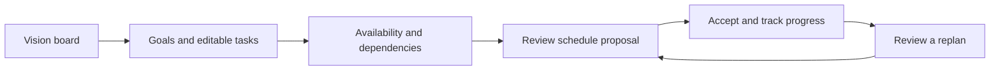

<div align="center">


<br />

**A thoughtful space for big dreams and small, steady steps.**

Vision board → editable plans → realistic schedules → progress → reviewed replanning.

[](https://github.com/Prarth314/Elevatria-uplift-your-life/actions/workflows/ci.yml)


[](LICENSE)

[Visit Elevatria](https://elevatria-website.vercel.app) · [Explore the workflow](#the-workflow) · [Run locally](#quick-start) · [Architecture](#under-the-surface) · [Security](docs/SECURITY_AUDIT.md)

</div>

<br />

## Make room for what’s next

Elevatria is a visual goal-planning application built around a simple idea: the future you imagine deserves a practical next step. Keep inspiration in sight, define success, shape milestones and tasks, then work within the time you actually have.

The botanical palette, editorial typography, and central vision board support a technical core: validated data, dependency graphs, timezone-aware scheduling, reviewed schedule changes, and optional ownership-checked cloud storage.

> **Current release · Local planning, scheduling & security hardening**<br />
> The complete local workflow runs without signup, an API key, or a paid service. Optional Supabase account integration is implemented and locally tested, but no live project or OAuth flow has been verified. AI generation and Google Calendar sync are not enabled.



<p align="center"><sub>The actual local application, showing the included sample project.</sub></p>

## The workflow



| Step | What you can do today |
| :--- | :--- |
| **01 · Imagine** | Pin notes and processed images. Connect inspiration to a goal or keep it independent. |
| **02 · Define** | Describe an outcome, target date, weekly hours, constraints, category and scheduling priority. |
| **03 · Shape** | Generate a transparent category-based starter plan. Edit milestones, tasks, durations and prerequisite dependencies, including across goals. Cycles are rejected. |
| **04 · Make space** | Set recurring work windows, a planning timezone, fixed commitments, session limits and breaks. Generate a schedule across all goals. Inspect unscheduled work and its reasons. |
| **05 · Choose** | Review a proposal and allocation changes before acceptance. Compare half-budget or later-deadline scenarios without changing your board. |
| **06 · Keep moving** | Complete/reopen tasks; progress is weighted by estimated effort. Changes make an accepted schedule stale, so a new review is required before Calendar export. |
| **07 · Keep your work** | Export/restore JSON after review, retain accepted schedule history, and download an ICS file with stable task-occurrence IDs. |

The included **Build an AI study assistant** example has three milestones, nine concrete tasks and two completed tasks. It describes a project you could build; an AI assistant is not embedded in Elevatria. Reload the example from the desktop sidebar or mobile footer, or choose **Start fresh** for an empty board.

## Quick start

### 1. Prerequisites

| Tool | Version |
| :--- | :--- |
| Node.js | **24.x** |
| pnpm | **11.25.0**, pinned in package.json |
| Git | To clone the source |

```sh
node --version
npm install --global pnpm@11.25.0
pnpm --version
```

Skip pnpm installation if the pinned version is already available. The initial dependency installation needs network access.

### 2. Install and launch

```sh
git clone https://github.com/Prarth314/Elevatria-uplift-your-life.git
cd Elevatria-uplift-your-life
pnpm install --frozen-lockfile
npm run dev
```

Open the **Local** URL printed by Vite, normally [http://127.0.0.1:5173](http://127.0.0.1:5173). Keep the terminal running; press **Ctrl+C** to stop it. In the original local export, use the nested `elevatria-main` folder containing the root package.json and pnpm-workspace.yaml.

The root commands work in Windows PowerShell and macOS/Linux shells. **No .env or backend is required for the local demo.**

### 3. Try a complete journey

1. Create a goal with a deadline, weekly hours and a category. Generate and edit its starter plan.
2. Add a note or image to the vision board. Images must be PNG/JPEG/WebP under 1 MB and within supported dimensions.
3. Complete a task and inspect effort-weighted progress. Refresh to verify local persistence.
4. Open **Availability & planning preferences**. Add realistic work windows, choose your timezone, and save availability.
5. Generate a proposal. Review placements and unscheduled work; accept it explicitly.
6. Download the Calendar file or export the board JSON. Reopen a task or adjust availability and review a fresh replan before accepting it.

### Optional account storage

The local demo remains available when no cloud project is configured. [CLOUD_SETUP.md](docs/CLOUD_SETUP.md) explains how to prepare a **Supabase Free** project, apply **both SQL migrations**, configure GitHub OAuth and run the local API. No paid plan is required by the application.

Copy [.env.example](.env.example) to an ignored .env only when configuring the integration. Public Supabase URL/publishable keys belong in the documented VITE_ variables; privileged keys belong only in server variables. The build guards recognizable privileged browser configuration. Do not paste secrets into chat, commit them, or store provider API keys in localStorage.

For account development, run these in separate terminals:

```sh
npm run dev:api
```

```sh
npm run dev -- --port 5174
```

The API binds to 127.0.0.1:5176; Vite proxies /api to it. Restart both processes after changing configuration. Account sign-in never automatically uploads the local board. Account documents stay in memory until explicitly saved; sign-out restores the separate local demo.

### Useful commands

| Command | Purpose |
| :--- | :--- |
| `npm run dev` | Start the loopback-only development frontend |
| `npm run dev -- --port 5174` | Choose another frontend port |
| `npm run dev:api` | Start the optional local account API |
| `npm run typecheck` | Check frontend and server TypeScript |
| `npm test` | Run domain, security, service and PostgreSQL tests |
| `npm run build` | Build production output in src/frontend/dist |
| `npm run preview` | Preview the built frontend with production security headers |
| `npm run audit -- --history --dist` | Scan source, supported Git text history and output without echoing matched credentials |
| `pnpm audit --audit-level low` | Check the dependency graph against current advisories |
| `npm run benchmark` | Run repeatable synthetic scheduling measurements |

<details>
<summary><strong>Local setup troubleshooting</strong></summary>

- **Occupied port:** choose another port. Each origin/port has its own demo data; export before switching.
- **Old Node/pnpm:** use the versions above. Node's built-in TypeScript support runs the test suite and local API.
- **Storage warning:** export unsaved work before leaving. Corrupt stored data is preserved for recovery; another tab's changes block automatic overwrites until reload/review.
- **Cloud unavailable:** use the independent local demo; verify both migrations, credentials and OAuth redirect settings before retrying. Do not add billing to make local planning work.
- **Nothing fits:** check work windows, timezone, goal hours, dependencies and deadlines. The scheduler reports unplaced work rather than overbooking.
- **An invalid dependency edit is rejected:** remove a cyclic edge. Remove prerequisite references before deleting a task or milestone that other work depends on.
- **Cloud size limit:** cloud boards are capped at 1 MB, smaller than local backups. Reduce embedded images/history or retain a local backup.

</details>

## Under the surface

| Layer | Implementation |
| :--- | :--- |
| Interface | React 19, strict TypeScript, Vite 8, TanStack Router |
| Design | Tailwind CSS, scoped planner CSS, Radix dialogs, Lucide icons, self-hosted Inter/Playfair fonts |
| Domain | Pure template generation, schema validation, weighted progress and dependency graph checks |
| Scheduling | Deterministic earliest-deadline heuristic, global availability, timezone/DST handling, bounded Web Worker and independent invariant validator |
| Local persistence | Versioned localStorage adapter with visible failures and cross-tab overwrite protection |
| Optional cloud | Same-origin Node/Vercel API, verified Supabase GitHub identity, server-only PostgreSQL RPCs, optimistic revisions and shared account limits |
| Verification | Node test runner, PGlite PostgreSQL, TypeScript, package/source audits, immutable CI action pins |
| Retained experiment | Inactive Motoko / Internet Computer source and generated bindings |

```text
api/workspace.ts                   Vercel API entry point
src/server/                        Authentication, HTTP limits and repository adapter
src/frontend/src/pages/Planner.tsx  Workspace composition
src/frontend/src/planner/
  model.ts, structure.ts           Versioned data and strict validation
  planning.ts, templates.ts        Editable local starter plans
  dependencies.ts                  Graph validation
  scheduler.ts, time.ts            Scheduling algorithm and timezone handling
  schedule.worker.ts               Isolated, cancellable computation
  SchedulePanel.tsx                Review, scenarios and accepted history
  persistence.ts                   Demo/account storage boundary
  CloudPanel.tsx                   Optional explicit account controls
  images.ts, portability.ts        Bounded image processing, JSON and ICS
  Editors.tsx, planner.css         Accessible editing and responsive design
database/migrations/               Ordered PostgreSQL schema and security changes
tests/                             Domain, cloud, database and security regressions
docs/                              Setup, decisions, audit and verification
```

The scheduler checks durations, shared windows, fixed commitments, deadlines, weekly goal budgets, breaks and prerequisite completion. It splits long tasks across sessions and explains remaining work. Nonexistent DST wall times are skipped with a warning; repeated times choose the earlier occurrence. The heuristic **does not prove optimality or infeasibility of every alternative arrangement**.

Replanning recomputes unfinished work from now and requires review before replacement. It does not yet preserve manually locked slots, minimize disruption, infer completion, or interpret free-text constraints. Accepted history is bounded. Weekly focus remains a simpler ordered budget view; it is distinct from the scheduler.

The original Motoko backend has no goal/task API and depends on separate platform tooling. Keeping it inactive lets the web application remain Vercel-compatible while the conventional API provides testable ownership and concurrency boundaries. Legacy shell deployment entry points stop immediately; no canister is provisioned. See [ARCHITECTURE.md](docs/ARCHITECTURE.md).

## Clear about what works

| Area | Implemented | Remaining |
| :--- | :--- | :--- |
| Planning | Editable category templates, goals, milestones, tasks and dependencies | Optional server AI with validated responses |
| Scheduling | Availability, timezone, deadlines, breaks, task splitting and reviewed proposals | Optimal search, session locks and minimal-disruption repair |
| Account storage | Optional PKCE SDK, authenticated API, SQL permissions/revisions and explicit load/save/delete | Real OAuth/two-account/hosted verification, account deletion and operational policy |
| Portability | Reviewed JSON restore and stable-UID ICS download | Google Calendar remote sync, idempotent reconciliation and failure recovery |
| Security | Strict boundaries, resource limits, CSP, dependency/source CI checks | Live platform assessment and independent review before public account access |

The local demo is **one unencrypted board per browser origin**, not an authorized account store. Clearing browser data removes it. Account sessions use tab-scoped sessionStorage; account documents are kept out of the demo store. Export files contain your board. Retired prototype auth/provider-key entries are removed on startup without reading their contents; unrelated legacy board/chat data is preserved.

## Verification and security

The current suite has **38 passing tests** covering schedule constraints/randomized graphs, DST, validation, weighted progress, backups, Calendar escaping/identity, storage failures, account ownership, PostgreSQL permissions/rate limits/revision reuse, input bounds and configuration safeguards. Frozen installation, frontend/server type checking, production build, source/history/output scan and package audit pass locally.

Browser checks cover desktop/mobile layouts, goal/task editing, keyboard completion, focus recovery, cyclic-edit rejection, safe text rendering, processed images, schedule review/acceptance and file operations. [VERIFICATION.md](docs/VERIFICATION.md) records evidence and limits. [SECURITY_AUDIT.md](docs/SECURITY_AUDIT.md) lists findings, remediations and the remaining operational plan; [SECURITY.md](SECURITY.md) explains private reporting.

These checks do not establish production readiness. Live Supabase OAuth/storage, external AI, Google Calendar writes and Motoko deployment remain unverified. Hosted routing and anonymous/unconfigured API responses are verified; see the [deployment record](docs/VERCEL.md).

## Hosting and next steps

The frontend builds to src/frontend/dist. [vercel.json](vercel.json) supplies static routing and security headers; api/workspace.ts requires a Node serverless function only when account storage is enabled. Supabase is a separate optional backend. See [Vercel setup and deployment verification](docs/VERCEL.md). Free service limits and availability must be reviewed before connecting real users; unlimited free operation is not promised.

- [x] **Core workflow:** visual boards, editable plans, progress, sample project, persistence and responsive editing.
- [x] **Local scheduling:** dependency-aware proposals, scenarios, acceptance, history and file portability.
- [x] **Security remediation:** bounded inputs, account isolation safeguards, SQL concurrency/rate limits and CI protections.
- [ ] **Live account validation:** configure a free development project and verify real OAuth, two-user isolation and hosted behavior.
- [ ] **Further planning intelligence:** optional free/local AI experiments with a reliable template fallback, session locks and repair strategies.
- [ ] **Calendar integration:** user-reviewed remote synchronization with durable idempotency and partial-failure recovery.

## Project notes

- [Original codebase assessment](docs/ASSESSMENT.md) — historical inspection of the starting export.
- [Architecture](docs/ARCHITECTURE.md) — boundaries and backend tradeoffs.
- [Vercel hosting](docs/VERCEL.md) — correct repository root, build settings and troubleshooting.
- [Cloud setup](docs/CLOUD_SETUP.md) — optional, free-service development steps.
- [Security audit](docs/SECURITY_AUDIT.md) — findings and remaining verification.
- [Verification](docs/VERIFICATION.md) — checks actually performed.

Developed by **[Prarth Gupta](https://github.com/Prarth314)**. Existing source licenses and attribution are preserved. Required botanical artwork remains; unused prototype screenshots were removed. The board landscape is CSS, interface icons are Lucide, and the README banner is repository-native SVG. Font licenses ship in src/frontend/public/licenses.

---

<div align="center">

### Open source. Room to grow.

[](LICENSE)

Free to use, modify, and share under the **[MIT License](LICENSE)**.<br />
Keep the copyright and license notices with redistributed copies.

</div>

<details>
<summary><strong>Read the full MIT License</strong></summary>

```text
MIT License

Copyright (c) 2026
Copyright (c) 2026 Prarth Gupta

Permission is hereby granted, free of charge, to any person obtaining a copy of
this software and associated documentation files (the "Software"), to deal in
the Software without restriction, including without limitation the rights to
use, copy, modify, merge, publish, distribute, sublicense, and/or sell copies of
the Software, and to permit persons to whom the Software is furnished to do so,
subject to the following conditions:

The above copyright notice and this
permission notice shall be included in all copies or substantial portions of the
Software.

THE SOFTWARE IS PROVIDED "AS IS", WITHOUT WARRANTY OF ANY KIND,
EXPRESS OR IMPLIED, INCLUDING BUT NOT LIMITED TO THE WARRANTIES OF
MERCHANTABILITY, FITNESS FOR A PARTICULAR PURPOSE AND NONINFRINGEMENT. IN NO
EVENT SHALL THE AUTHORS OR COPYRIGHT HOLDERS BE LIABLE FOR ANY CLAIM, DAMAGES OR
OTHER LIABILITY, WHETHER IN AN ACTION OF CONTRACT, TORT OR OTHERWISE, ARISING
FROM, OUT OF OR IN CONNECTION WITH THE SOFTWARE OR THE USE OR OTHER DEALINGS IN
THE SOFTWARE.
```

</details>

<p align="center">
  <sub>© 2026 Prarth Gupta · Licensed under MIT.</sub><br />
  <br />
  <em>Built for intention. Made for real life.</em><br />
  <sub>Elevatria — Uplift Your Life</sub>
</p>
